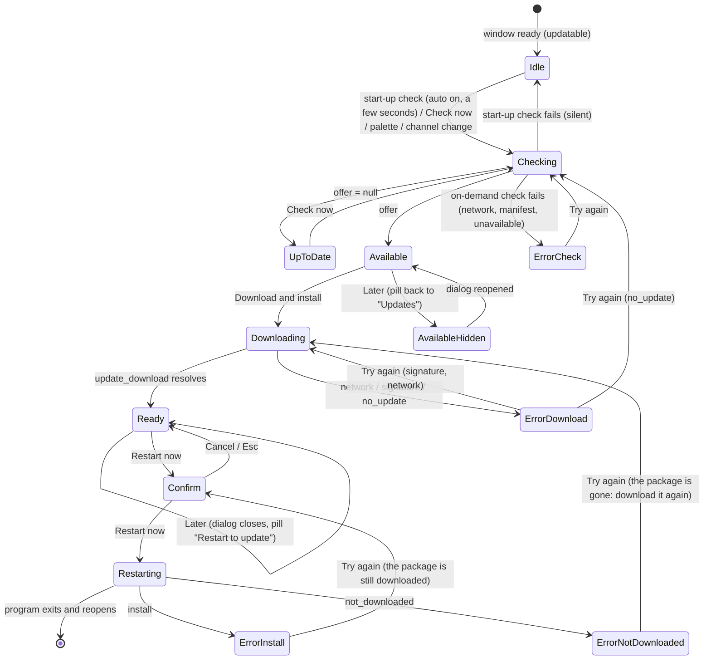

# Auto-update — flow, states and copy

For ui-1 (boards) and front-1 (implementation). Product rules: `spec.md` D4; commands: `api-contract.md`; first brief: `ux-brief.md`. Wireframes: `design/wireframes/` (SVG, listed at the end).

## 1. Decisions

### 1.1 Home of the notice: one title-bar button that becomes a pill

**Choice.** A single control in the title bar, between **Console** and the Language list. It is a ghost button labelled **Updates** while nothing is pending, and turns into an accent **pill** when something needs the user (update available, downloading, ready to restart, download failed). It opens the Updates dialog. Same element, same tab stop, same shortcut, so the entry point and the notice are never two things to learn.

**Why not a banner.**
- A banner pushes the workspace down and shifts the viewport at an arbitrary moment (a few seconds after start), exactly when the user starts working. A pill moves nothing.
- `Banner` is a `role="alert"` error component for forms; an update is neither urgent nor an error. The brief wants a polite `role="status"` notice.
- Download progress and "ready to restart" are long-lived states; a banner would have to stay for hours, or be dismissed and then be unreachable. The pill stays, shows progress and is always one click from the dialog.
- "Later" has an obvious meaning: the pill goes back to the plain **Updates** button. Nothing is lost, nothing nags.

**Why not a toast.** Board 3.20 toasts are transient and carry an Undo; an update notice must still be there ten minutes later.

The pill never takes focus, never opens anything by itself and does not animate (no pulsing; the colour and text carry the state, so reduced-motion needs no special case beyond the spinner).

### 1.2 How the Updates dialog is reached

| Way in | Result |
| --- | --- |
| Title-bar **Updates** button / pill | Opens the dialog on the current state, no new check. |
| **Ctrl+Shift+U** (Cmd+Shift+U on macOS) | Same as the button. Added to the shell shortcuts; ignored while a modal is open, like the others. |
| Command palette **Check for updates** | Opens the dialog and starts a check at once (skipped when a download is running or the update is ready: it just opens the dialog). |
| Command palette **About BIMCraft** | Opens the same dialog, no check. The version line is the "about". |
| The pill (when an update is pending) | Same as the button. |

When `updatable` is false (development build, browser): no button, no pill, no shortcut, no palette entries, no announcements, no dialog.

### 1.3 Other decisions

- Changing the channel runs a check on the new channel at once (it is an explicit user action, so errors show). The channel control is **disabled** while checking, downloading or ready to restart, with a one-line reason, because a new check would discard the downloaded package.
- The restart confirmation replaces the Updates dialog (it is not stacked on it): one modal at a time keeps focus handling and the existing `Dialog` simple. Cancel returns to the Updates dialog.
- "Later" in the dialog closes it and puts the pill back to the plain button for **Available**, and to **Restart to update** for **Ready** (a downloaded update stays visible: it is waiting for the user). Neither is remembered across starts.
- Release notes and the "recovery copy" paragraph are text only. The brief's links to the website and to "Recover unsaved work" are written as **plain text, not links**: the API contract has no command to open a URL, and a webview link would navigate the app window. (Open question for lead, section 9.)

## 2. Flow

Pill by state: Idle / UpToDate / ErrorCheck / AvailableHidden → **Updates** (ghost). Available → **Update available** (pill). Downloading → **Downloading {percent}%** (pill). Ready, Confirm, Restarting, ErrorInstall → **Restart to update** (pill). ErrorNotDownloaded → **Update failed** (pill, danger tone). ErrorDownload → **Update failed** (pill, danger tone).

Retry rules: a failed check retries the check; a failed download (`network`, `signature`) retries `update_download`; `no_update` retries a check; a failed install (`install`) stays on the Ready screen with the error above it (the package is still downloaded) and **Try again** reopens the restart confirmation, so the user decides again; `not_downloaded` means the host has no package, so **Try again** downloads it again (retrying the install would fail the same way).

## 3. Updates dialog layout (all states)

Top to bottom, in one scroll-free column (the release notes box is the only scroller), width like the Materials dialog:

1. Title (h2) **Updates** and the **Close** button (X, labelled).
2. Version line.
3. Channel fieldset: `SegmentedToggle` (Stable · Beta), then the help line of the chosen channel, then the optional beta/stable note.
4. Switch **Check for updates automatically** and its help line.
5. Status area (`role="status"`, `aria-live="polite"`, always in the DOM): the state's headline and details. Errors use a `Banner` (`role="alert"`) placed right after the status area, **not inside it**: nesting an alert in a polite live region makes screen readers announce the text twice.
6. Release notes box (Available only): label "What's new in {version}", plain text, `white-space: pre-wrap`, max height about 8 lines, `tabindex="0"` so keyboard users can scroll it.
7. Footer: the state's actions, **Check now** as the secondary action on the left when the state allows it, primary on the right.

## 4. States

Focus rule for all states: the dialog opens with focus on the first enabled primary action of the state (table below); when the state changes while focus is on the dialog container or on a control that just became disabled or removed, focus moves to the new primary action (or to **Close** when there is none). Otherwise focus stays where the user put it. Esc closes the dialog (it is **not** inert while downloading) except in Restarting. Focus returns to the opener on close (already done by `Dialog`).

| State | Dialog shows | Actions (primary first) | Initial focus | Announcement (polite status unless said) |
| --- | --- | --- | --- | --- |
| **Idle** (no check yet this session, or start-up check failed) | Version, channel, switch; status "Select Check now to look for a newer version." | **Check now** | Check now | none |
| **Checking** | Status with spinner "Checking for updates…" | Check now disabled (`aria-disabled`, keeps its place), channel and switch stay usable except channel (disabled) | dialog container | "Checking for updates…" |
| **Up to date** | "BIMCraft {version} is up to date." and "Last checked {time}." | **Close**, Check now | Close | "BIMCraft {version} is up to date." |
| **Available** | "BIMCraft {version} is available." "Released {date}." hint, release notes box | **Download and install**, **Later**, Check now | Download and install | Dialog: none extra (focus moves). Pill when the dialog is closed (start-up check): "BIMCraft {version} is available. Open Updates to download it." once per version per session |
| **Downloading** | "Downloading BIMCraft {version}…", progress bar, size text, hint "You can close this window; the download continues." | **Close** (no cancel: the host has none). Channel disabled. | Close | "Downloading BIMCraft {version}…" once; progress is not announced continuously (the bar exposes `aria-valuenow` and `aria-valuetext`) |
| **Ready to restart** | "BIMCraft {version} is ready to install." "Restart BIMCraft to finish the update." | **Restart now**, **Later** | Restart now | Dialog open: "BIMCraft {version} is ready to install." Dialog closed: "BIMCraft {version} is ready to install. Open Updates to restart." |
| **Restart confirmation** (own dialog, "alert" content, not `role=alertdialog`: nothing is wrong) | Title, what happens, what is lost, recovery copy | **Restart now** (primary), **Cancel** | **Cancel** (safe default for an action that closes the program) | Dialog title is read on open |
| **Restarting** | Confirmation closes; Updates dialog reopens with "Restarting BIMCraft…" and a spinner | none (all disabled) | dialog container | "Restarting BIMCraft…" |
| **Error — offline** (`network`) | Banner "Could not reach the update server. Check your internet connection and try again." | **Try again**, Close | Try again | alert (Banner) |
| **Error — signature** (`signature`) | Banner "The downloaded update could not be verified, so it was not installed. Your current version is unchanged." + hint | **Try again**, Close | Try again | alert |
| **Error — manifest** (`manifest`) | Banner "The update information could not be read right now." + hint | **Try again**, Close | Try again | alert |
| **Error — install** (`install`) | Ready screen with Banner "BIMCraft could not install the update. Your current version is unchanged." + hint | **Try again** (= back to the confirmation), Close | Try again | alert |
| **Error — not downloaded** (`not_downloaded`) | Banner "BIMCraft could not install the update. Your current version is unchanged." + hint, on the Available screen | **Try again** (= download again), Close | Try again | alert |
| **Error — other** (`no_update`, `unavailable` when a call is still made) | Banner "Something went wrong with the update. Check again to continue." | **Check now** | Check now | alert |
| **Beta selected** | Channel line + beta note (always shown while Beta is chosen) | unchanged | unchanged | none |
| **Stable chosen while running a beta** (version has a `-` suffix) | Note "You are running a beta. It stays installed until a newer Stable version is released." | unchanged | unchanged | none |
| **Start-up silent failure** | Nothing visible; pill stays "Updates"; dialog opens in Idle | — | — | none |
| **Updates unavailable** | nothing at all | — | — | none |

Pill states (not modal, never focus-stealing): see section 2. The pill's accessible name equals its text, plus the version for **Update available** ("Update available: BIMCraft {version}"). `aria-haspopup="dialog"`, `aria-keyshortcuts="Control+Shift+U Meta+Shift+U"`.

Keyboard summary: Tab order in the dialog is title close → channel buttons → switch → release notes (when present) → footer actions. Space/Enter activate the toggle buttons; Space toggles the switch. Esc closes, Esc in the confirmation cancels. F6 regions are unchanged (the pill is in the title-bar region).

## 5. Time, size and number formats

- `{time}` and `{date}`: `Intl.DateTimeFormat` in the interface language (`{time}` medium date + short time, `{date}` medium date). A manifest without a date hides the "Released" line.
- `{downloaded}` and `{total}`: decimal units, one decimal under 10 (`2.4 MB`, `38 MB`), via a small formatter; `{percent}`: whole number, floor, only when `total` is known.
- Unknown total: indeterminate bar (no `aria-valuenow`), text "{downloaded} downloaded".

## 6. English copy

Keys suggest the catalogue names (`updates.*`, both catalogues, UI-04). `{…}` are placeholders. French is about 30 % longer: buttons wrap or grow, no fixed widths.

### Title bar and shortcuts

| Key | English |
| --- | --- |
| `updates.open` | Updates |
| `updates.pill.available` | Update available |
| `updates.pill.availableLabel` | Update available: BIMCraft {version} |
| `updates.pill.downloading` | Downloading {percent}% |
| `updates.pill.downloadingUnknown` | Downloading… |
| `updates.pill.ready` | Restart to update |
| `updates.pill.failed` | Update failed |
| `updates.palette.check` | Check for updates |
| `updates.palette.about` | About BIMCraft |

### Dialog

| Key | English |
| --- | --- |
| `updates.title` | Updates |
| `updates.close` | Close (aria-label of the X) |
| `updates.version` | You are running BIMCraft {version}. |
| `updates.channel.label` | Update channel |
| `updates.channel.stable` | Stable |
| `updates.channel.beta` | Beta |
| `updates.channel.stableHelp` | Recommended. Releases that have been tested. |
| `updates.channel.betaHelp` | Early access to new features. It may contain bugs. |
| `updates.channel.betaNote` | Use Beta only if you accept occasional problems. You can go back to Stable at any time. |
| `updates.channel.fromBetaNote` | You are running a beta. It stays installed until a newer Stable version is released. |
| `updates.channel.locked` | The channel cannot change while an update is being checked, downloaded or waiting for a restart. |
| `updates.auto.label` | Check for updates automatically |
| `updates.auto.help` | BIMCraft checks once each time it starts. It never downloads or installs anything without asking you. The check only fetches a public file: no project data and no account information is sent (the server sees your IP address, like any website). |
| `updates.checkNow` | Check now |
| `updates.idle` | Select Check now to look for a newer version. |
| `updates.checking` | Checking for updates… |
| `updates.upToDate` | BIMCraft {version} is up to date. |
| `updates.lastChecked` | Last checked {time}. |
| `updates.available` | BIMCraft {version} is available. |
| `updates.released` | Released {date}. |
| `updates.availableHint` | BIMCraft downloads the update first, then asks before it restarts. |
| `updates.notes.label` | What's new in {version} |
| `updates.notes.empty` | No release notes were provided. |
| `updates.download` | Download and install |
| `updates.later` | Later |
| `updates.downloading` | Downloading BIMCraft {version}… |
| `updates.progress.known` | {downloaded} of {total} |
| `updates.progress.unknown` | {downloaded} downloaded |
| `updates.progress.percent` | {percent}% (next to the size text, only when the total is known) |
| `updates.progress.label` | Download progress |
| `updates.downloadingHint` | You can close this window. The download continues. |
| `updates.ready` | BIMCraft {version} is ready to install. |
| `updates.readyHint` | Restart BIMCraft to finish the update. You can do it later. |
| `updates.restart` | Restart now |
| `updates.restarting` | Restarting BIMCraft… |
| `updates.retry` | Try again |

### Restart confirmation

| Key | English |
| --- | --- |
| `updates.confirm.title` | Restart BIMCraft now? |
| `updates.confirm.body` | BIMCraft closes and reopens as version {version}. Open dialogs and changes you have not applied yet, such as a build-up you are still editing, are lost. |
| `updates.confirm.recovery` | BIMCraft keeps a recovery copy of your work while you edit. After the restart, open your project again: if BIMCraft finds a recovery copy, it offers to restore it. See "Recover unsaved work" in the user guide. **Show this paragraph only once the interface really autosaves**: today (`docs/user/recover-unsaved-work.md`) the autosave is not wired to the UI, so the paragraph would promise a copy that does not exist; until then the body alone is shown. |
| `updates.confirm.restart` | Restart now |
| `updates.confirm.cancel` | Cancel |

No sentence says that the model is saved or that the user should save first: the UI has no Save yet (when it has, add "Save your project first" above the recovery paragraph).

### Errors

| Key | English |
| --- | --- |
| `updates.error.network` | Could not reach the update server. Check your internet connection and try again. |
| `updates.error.signature` | The downloaded update could not be verified, so it was not installed. Your current version is unchanged. |
| `updates.error.signatureHint` | Try again later. If this keeps happening, download BIMCraft again from the BIMCraft website. |
| `updates.error.manifest` | The update information could not be read right now. |
| `updates.error.manifestHint` | Try again later, or download the latest version from the BIMCraft website. |
| `updates.error.install` | BIMCraft could not install the update. Your current version is unchanged. |
| `updates.error.installHint` | Try again, or download the latest version from the BIMCraft website. |
| `updates.error.other` | Something went wrong with the update. Check again to continue. |

### Status announcements (visually hidden live region in the shell, polite)

| Key | English |
| --- | --- |
| `updates.announce.available` | BIMCraft {version} is available. Open Updates to download it. |
| `updates.announce.ready` | BIMCraft {version} is ready to install. Open Updates to restart. |
| `updates.announce.failed` | The update could not be downloaded. Open Updates for details. |

Error mapping: `network` → network; `signature` → signature; `manifest` → manifest; `install` and `not_downloaded` → install (same text; `not_downloaded` retries the download, `install` retries the restart); `no_update`, `unavailable` → other. The host `message` is never shown.

## 7. Settings persistence and start-up

Channel and **Check for updates automatically** are stored per computer like the language. Defaults: Stable, on. At start-up, with the switch on and `updatable`, check once after the window has been ready for about 5 seconds and no modal is open (retry-free); failure is silent; a found offer only turns the pill into **Update available** and posts the one announcement. Turning the switch off cancels a pending start-up check.

## 8. Docs to write alongside (AGENTS.md section 6)

A user-guide page "Update BIMCraft" (EN + FR): channels, the automatic check, what a check sends (nothing but the request for a public file), restart consequences with the recovery copy, moving from Beta to Stable, offline use. Add the Ctrl+Shift+U shortcut to `use-the-workspace-with-the-keyboard.md`.

## 9. Open questions for lead

1. Links: the contract has no "open URL" command. OK to keep the website and the user guide as plain text, or should back add one (allow-listed hosts only)?
2. The palette does not exist in code yet (board 8.4 only). Palette entries are specified here so they are added when it lands; until then the title-bar button and the shortcut are the only ways in.
3. Windows shows the NSIS installer in passive mode during the restart (progress window); the confirmation does not mention it. Add a line if lead wants it.

## 10. Wireframes

Low fidelity, light mode only; ui draws light and dark.

- `design/wireframes/01-title-bar-entry.svg` — the button and every pill state; unavailable build.
- `design/wireframes/02-dialog-idle-and-up-to-date.svg`
- `design/wireframes/03-dialog-checking.svg`
- `design/wireframes/04-dialog-available.svg`
- `design/wireframes/05-dialog-downloading.svg`
- `design/wireframes/06-dialog-ready.svg`
- `design/wireframes/07-restart-confirmation.svg`
- `design/wireframes/08-dialog-error.svg` — offline; the signature, manifest and install variants change only the Banner text and hint.
- `design/wireframes/09-dialog-beta.svg` — Beta chosen, and the "running a beta, Stable chosen" note.

## 11. Lead decisions (after the ui-1 review)

These settle section 9 and the points ui-1 left open; they override anything above that disagrees.

1. **Links stay plain text.** No "open URL" command is added: the window keeps exactly the four update commands.
2. **Palette entries** are added when the command palette exists; until then the title-bar button and the shortcut are the ways in.
3. **Windows installer window**: the restart confirmation gets one more line on Windows only, `updates.restart.windowsNote`: "On Windows, an installer window shows its progress for a few seconds before BIMCraft opens again." (French in the catalogue.)
4. **Restart confirmation replaces the Updates dialog** (unchanged). Focus: **Cancel** closes the confirmation and reopens the Updates dialog with focus on its **Restart now** button; after a failed install the Updates dialog reopens on the Ready screen with the error and focus on **Try again**; closing the Updates dialog then returns focus to the element that first opened it (the title-bar button/pill, or the viewport when it came from the palette or the shortcut). The front keeps the opener reference across the swap.
5. **Pill during Checking**: no change. The button keeps its current look and label ("Updates", or the pill of an earlier offer); checking is shown only inside the dialog.
6. **Start-up check while the dialog is open**: when the user opened the dialog while the silent start-up check runs, the dialog shows Checking, and a failure is then shown like an on-demand check (error Banner and Try again): the user is looking. With the dialog closed it stays silent.
7. **MSI installations on Beta** (spec D2): the `manifest` error text covers it; the update guide explains that MSI installations follow the stable channel only.
