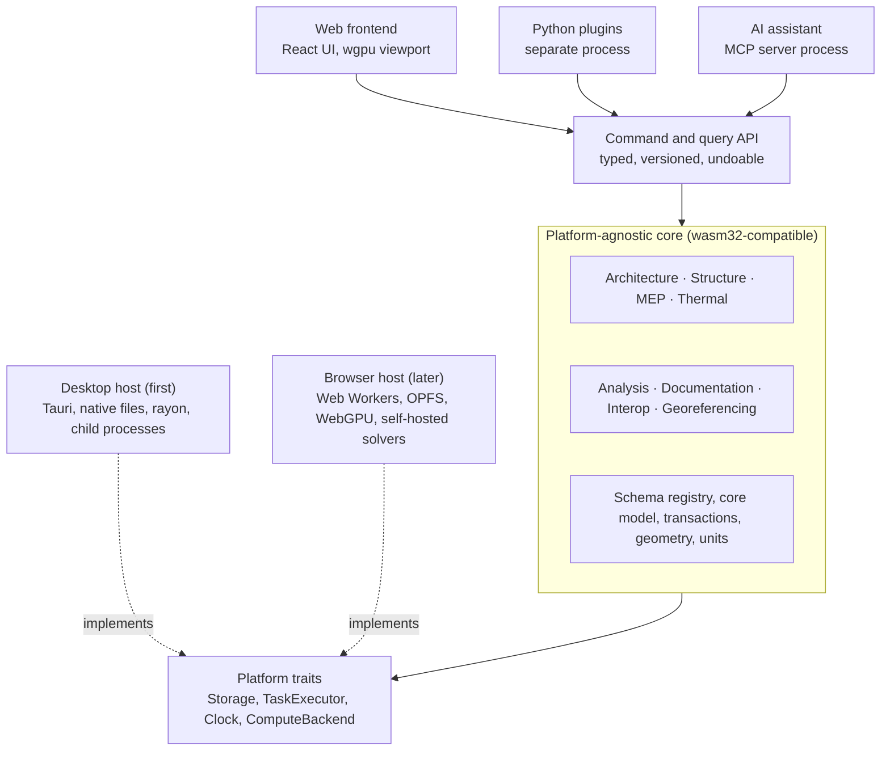

# BIMCraft — Specifications v0.1

Status: draft for discussion · October 13, 2026

## 1. Purpose and vision

BIMCraft is an open-source (MIT licence), multi-discipline BIM authoring tool, written from scratch in Rust, that takes a construction project from early studies to construction drawings in one shared model. It runs on desktop first and in the browser later, from the same core code.

The product produces three kinds of deliverables from a single source of truth: 3D models, 2D documentation (plans, sections, elevations, sheets) and calculation reports. It covers buildings and civil works, including bridges, across architecture, structure, MEP and thermal engineering.

**Guiding principles**

1. One model, many views: every drawing, schedule and report is derived from the model, never drawn separately.
2. One public API: the UI, Python plugins and the AI assistant all use the same command and query API.
3. A platform-agnostic core: the core compiles to native and to WebAssembly; platform code lives only in hosts.
4. IFC-aligned, not IFC-bound: a proprietary model whose concepts map one-to-one onto IFC 4.3.
5. Progressive detail: any element can exist at a coarse level of detail and be refined without being redrawn.

**Conventions.** MUST marks a requirement for the release where it is scheduled. SHOULD marks a strong recommendation that can be deferred with a written reason. Requirement IDs (CORE-01, GEO-01…) are stable and referenced by tests and issues. Priority column values: MVP, V1, Later. Applied to model elements, component, type and instance have their glossary meaning (16.3).

**Status.** First draft for discussion. Sections 5, 6 and 12 are the most structuring and should be reviewed first.

## 2. Scope

The MVP is a structure-and-architecture desktop tool: design a reinforced concrete and steel building, georeference it, document it from planning permit to construction drawings, produce a basic calculation report and round-trip it through IFC. Everything else is scoped in, but scheduled later.

| Area | MVP | V1 | Later |
| --- | --- | --- | --- |
| Platforms | Windows, macOS desktop | Linux desktop | Browser (WASM) |
| Disciplines | Structure (RC with reinforcement, steel); core architecture (building elements, door and window components, curtain walls, massing, spaces and area schemes) | Timber; advanced architecture (section 8.2); phases and design options; embodied carbon; MEP networks; fire safety | Thermal, acoustics, accessibility, daylight analysis, freeform architecture, bridges and civil works |
| Geometry | Extrusions, sweeps, planar booleans, rebar detailing, steel connections | — | Freeform / NURBS surfaces |
| Documentation | Plans, sections, elevations, details, sheets, area tables, room, door, window, quantity and rebar schedules, PDF export | Other schedules, colour-filled and presentation views, DXF export | DWG export |
| Analysis | Linear static FEM (bars) | Shells, Eurocode checks | Dynamic, thermal (RE2020 energy) |
| Interop | IFC 4.3 import/export, rebar and steel fabrication export (BVBS, DSTV/NC1) | DXF, BCF, point clouds, glTF export | DWG, RVT via Revit add-in |
| Extensibility | Command API, Python SDK | MCP server, visual node editor, component editor | Plugin marketplace |
| Collaboration | Single user, local files | Model linking | Real-time multi-user |

**Out of scope** (no plan to build): photorealistic rendering, construction scheduling (4D) and costing (5D), site management, and facility management. These are served by exporting to specialised tools (glTF for rendering, see INT-06).

**Explicit non-goal.** Reading native .rvt files without Revit. See section 11.

## 3. Users and disciplines

The primary user is the engineer or designer in a design office from feasibility to construction drawings. Secondary users are developers who extend the product and project stakeholders who only review.

| Persona | Main tasks | What they need most |
| --- | --- | --- |
| Structural engineer | Model RC, steel and timber structures, run analysis, produce reports | Analytical model derived from the physical one, code checks, traceable results |
| Structural draftsperson | Formwork and reinforcement drawings, rebar schedules | Fast detailing tools, reliable live views, DWG/PDF output |
| Architect | Massing, programme, site, façades, spaces, interiors, renovation, permit, tender and construction drawings | Massing linked to building elements, parametric components at several levels of detail, live area tables against the programme, planning-rule checks, presentation views |
| MEP engineer (HVAC, electrical, plumbing) | Networks, equipment, sizing | System graphs, sizing calculations, clash detection |
| Thermal engineer | Envelope, zones, energy calculations | Thermal zones and envelope data extracted from the model |
| BIM manager | Coordination, IFC exchanges, standards | Robust IFC round-trip, BCF issues, project templates |
| Plugin developer | Automate tasks, add tools | Stable, documented Python API and command protocol |
| Reviewer (later, browser) | View, measure, comment | Lightweight access with no install |

## 4. Architecture overview

The core is a headless Rust engine; every client (UI, Python, AI) drives it through one command and query API. The core is split into crates that never touch the platform directly, so the same code runs natively on desktop and as WebAssembly in the browser.

Arrows point from a caller to what it calls; the two hosts implement the platform traits the core depends on.

**Process model (desktop).** The main process hosts the core, the API and the native window. Separate processes host the Python plugin runtime, the MCP server, the solvers and the file converters, so a crash in any of them never takes down the model.

**Process model (browser).** The frontend runs on the main thread; the core runs in a Web Worker; solvers run in further workers or on a self-hosted server. The same traits hide the difference.

| Crate group | Content | Platform rule |
| --- | --- | --- |
| `schema` | Entity definition parser, validator, canonical model and registry | wasm32-compatible |
| `schema-gen` | Code and documentation generators for core entities (section 5.1) | Build-time only |
| `core-model` | Entities, attribute tables, relationships, IDs, units, derived-data dependency graph | wasm32-compatible |
| `core-txn` | Commands, transactions, undo/redo, events | wasm32-compatible |
| `geom` | Geometry kernel, representations, tessellation | wasm32-compatible |
| `persist` | Project files as SQLite databases: schema version, migrations (section 5.3) | wasm32-compatible |
| `georef` | Coordinate systems, map conversion | wasm32-compatible |
| `disc-arch`, `disc-struct`, `disc-mep`, `disc-thermal` | Discipline entities, tools, rules | wasm32-compatible |
| `analysis` | Analytical models, solver orchestration, results | wasm32-compatible |
| `docgen` | Views, hidden lines, annotation, sheets | wasm32-compatible |
| `interop-ifc`, `interop-dxf`, `interop-bcf` | Import and export | wasm32-compatible |
| `api` | Command and query protocol, schema export | wasm32-compatible |
| `render` | wgpu renderer | Native and WebGPU |
| `platform` | Traits: Storage, TaskExecutor, Clock, ComputeBackend | Interfaces only |
| `host-desktop`, `host-web` | Platform implementations, IPC, windowing | Platform-specific |
| `solver-*`, `plugin-host`, `mcp-server` | Out-of-process binaries | Native (web variants later) |

**Rules enforced in CI**

- ARCH-01 (MVP): every crate marked wasm32-compatible MUST build for `wasm32-unknown-unknown` on every commit.
- ARCH-02 (MVP): core crates MUST NOT use `std::fs`, `std::thread`, `std::time::Instant`, sockets or blocking I/O.
- ARCH-03 (MVP): discipline crates MUST depend only on the public extension interfaces of the core, the same ones offered to plugins.
- ARCH-04 (MVP): no crate may depend on a crate in a higher layer.

## 5. Core model kernel

The model is proprietary and IFC-aligned: every internal concept maps to an IFC 4.3 concept, but the internal schema is free to add parametric behaviour IFC cannot express. The schema is written once, declaratively, and code and documentation are generated from it.

**5.1 Schema as the single source of truth**

Each entity definition declares its attributes, property sets, allowed relationships, representations and IFC mapping. For core entities, build-time generators produce the Rust types, serialization, the API schema, Python type stubs, the IFC mapping code and the reference documentation. Plugin entities (PY-04) use the same format and are loaded at runtime into the same registry; CORE-10 applies to them too.

**5.2 Requirements**

| ID | Requirement | Priority |
| --- | --- | --- |
| CORE-01 | Every object MUST carry a stable 128-bit GUID, convertible to and from IFC GlobalId. | MVP |
| CORE-02 | Components, types and instances MUST be separate: an instance inherits from its type and may override allowed properties. | MVP |
| CORE-03 | Relationships MUST be first-class objects (aggregation, containment, connection, voiding, assignment), mirroring IfcRel\* semantics. | MVP |
| CORE-04 | Properties MUST be grouped in property sets with typed values and units; custom property sets MUST be definable by users and plugins. | MVP |
| CORE-05 | Storage SHOULD keep entity data in typed attribute tables for memory locality on large models. | MVP |
| CORE-06 | Every change MUST go through a command executed inside a transaction; transactions are atomic and undoable. | MVP |
| CORE-07 | Every transaction MUST emit a change event listing created, modified and deleted objects. | MVP |
| CORE-08 | Derived data (geometry, views, analytical models) MUST be recomputed through a dependency graph, lazily and incrementally. | MVP |
| CORE-09 | Units MUST be explicit everywhere; internal storage uses SI, display follows project settings. | MVP |
| CORE-10 | Each schema entity MUST have an entry in the IFC mapping table (entity + predefined type), covered by round-trip tests. | MVP |
| CORE-11 | Commands MUST be serializable, so that history, macros, replay and future collaboration share one mechanism. | MVP |
| CORE-12 | The model SHOULD support partial loading by storey, zone or discipline. | V1 |
| CORE-13 | Projects MUST be able to link other project files read-only (model linking). | V1 |
| CORE-14 | Zones MUST be first-class groups of objects (IfcZone), usable by every discipline (apartments, fire compartments, thermal zones). | V1 |
| CORE-15 | Phases (existing, demolished, new, temporary) MUST be assignable to any object, with phase filters in views. | V1 |
| CORE-16 | Design options MUST let variants of a part of the model be compared before one is retained. | V1 |

**5.3 Persistence**

The native file format is a SQLite database with a versioned schema. It works natively and in the browser over OPFS, gives atomic saves and allows partial loading. A custom binary format will be considered only if profiling shows SQLite is the bottleneck.

- PERS-01 (MVP): files MUST carry a schema version; the application MUST open files from all earlier versions through migrations.
- PERS-02 (MVP): a crash MUST never corrupt a saved file; autosave runs at a configurable interval.
- PERS-03 (V1): large binary data (point clouds, images) SHOULD be stored in side files referenced from the database.
- PERS-04 (MVP): components MUST be storable as standalone files in the native file format, versioned and migrated like project files (PERS-01); the component library (COM-03) is made of these files. Loading a component file is an import: INT-01 and INT-02 apply.

## 6. Geometry kernel

The geometry kernel is built from scratch and scoped to what construction needs first: profiles extruded or swept along paths, combined with robust booleans. Freeform surfaces come later. This is the highest technical risk of the project (see section 16).

**6.1 Levels of detail**

Every element holds several representations, computed on demand from the same parameters. A door, for instance, exists as a bounding box, as a simplified leaf and frame, and as a full assembly with hardware.

| Level | Typical content | Used for |
| --- | --- | --- |
| LOD 100 | Bounding volume or symbol | Massing, early studies |
| LOD 200 | Simplified body, correct envelope | Coordination, overall plans |
| LOD 300 | Precise geometry of the element | Detailed design, quantities |
| LOD 400 | Detailed parts (hardware, rebar, connections) | Execution details, fabrication |

**6.2 Requirements**

| ID | Requirement | Priority |
| --- | --- | --- |
| GEO-01 | 2D profiles MUST support lines and circular arcs, with holes. | MVP |
| GEO-02 | Solids MUST be creatable by extrusion, by sweep along a path, and by revolution. | MVP |
| GEO-03 | Booleans (union, difference, intersection) MUST be robust on planar faces, using exact predicates and an explicit tolerance policy. | MVP |
| GEO-04 | Parametric elements MUST be driven by a constraint solver (distances, angles, alignment, equality). | MVP |
| GEO-05 | Tessellation MUST be incremental: only changed elements are re-meshed. | MVP |
| GEO-06 | Each element MUST expose representations per level of detail; views pick the level they need. | MVP |
| GEO-07 | Model coordinates MUST be stored in double precision; rendering MUST use a local origin to avoid float32 jitter. | MVP |
| GEO-08 | Rebar geometry (bending shapes, covers, anchorage) MUST be generated from parameters. | MVP |
| GEO-09 | Curved surfaces (cylinders, cones, then NURBS) SHOULD be supported for complex façades and bridges. | Later |
| GEO-10 | Meshes from imports MUST be usable as-is when no solid can be rebuilt. | MVP |
| GEO-11 | Joins between elements (walls, slabs, beams, columns) MUST be resolved at L, T and X junctions, layer by layer for layered elements following their layer priority (MAT-03). Users MUST be able to allow or disallow each join, choose its style (butt, mitre, square-off) and which element runs through, and override layer priorities. | MVP |
| GEO-12 | A component editor MUST let users author parametric components (CORE-02) of any discipline (profiles, parameters, constraints, LOD representations) without code. | V1 |

**Acceptance target.** A test corpus of at least 1,000 boolean cases, including degenerate ones (coplanar faces, touching edges, near-zero volumes), runs in CI and MUST pass before each release.

## 7. Georeferencing

Every project is placed on Earth through a projected coordinate reference system, while modelling happens in a local engineering frame close to the origin. The link between the two follows IFC 4.3 (IfcMapConversion, IfcProjectedCRS).

| ID | Requirement | Priority |
| --- | --- | --- |
| GEOREF-01 | A project MUST define a projected CRS (EPSG code), a survey point and a project base point. | MVP |
| GEOREF-02 | The local frame MUST be linked to the CRS by translation, rotation (true north) and scale. | MVP |
| GEOREF-03 | Coordinate transformations MUST be implemented in the core, in Rust, for the MVP CRS set (see CRS strategy below), with definitions loaded from the EPSG registry. | MVP |
| GEOREF-04 | Users MUST be able to read and pick coordinates in local and projected systems. | MVP |
| GEOREF-05 | Vertical datums (e.g. NGF-IGN69) MUST be stored with elevations. | V1 |
| GEOREF-06 | Terrain MUST be importable from LandXML and point clouds, and represented as a surface. | V1 |
| GEOREF-07 | Linear referencing (alignments, stations) MUST be supported for roads and bridges, following IfcAlignment. | Later |
| GEOREF-08 | Context data (CityGML buildings, map tiles) SHOULD be displayable around the project. | Later |
| GEOREF-09 | Sun position MUST be computed from the georeference and a date, with static and animated shadow studies in plans and 3D views. | V1 |

**CRS strategy.** Projection maths is built from scratch; CRS definitions are data, not code.

1. Projection methods are implemented in Rust: Transverse Mercator and Lambert Conformal Conic first, with 7-parameter Helmert datum shifts.
2. CRS definitions are loaded as data from the EPSG registry rather than hand-coded (redistribution terms to check).
3. MVP set: WGS84 (EPSG:4326), Lambert 93 (2154), CC42 to CC50 (3942 to 3950), UTM zones on ETRS89 and WGS84.
4. Grid-based shifts (NTv2, geoid grids for NGF-IGN69 heights) come in V1.
5. Most projects only need the project CRS plus the IFC map conversion; CRS-to-CRS transforms mainly serve site-data imports.
6. Transformation results are tested in CI against PROJ outputs, with a 1 mm tolerance.

## 8. Discipline modules

Each discipline is a package that registers its entities, tools and rules through the same extension interfaces as third-party plugins. Disciplines share the core model, so a structural beam, an architectural wall and an HVAC duct can be checked against each other without export.

**8.1 Materials (shared)**

- MAT-01 (MVP): materials MUST be generic objects with a behaviour law and properties per design code (e.g. concrete C25/30 to EN 1992, steel S355 to EN 1993, timber GL24h to EN 1995).
- MAT-02 (MVP): a material library MUST ship with common European grades and be extensible by users and plugins.
- MAT-03 (MVP): layered materials (wall build-ups, slab build-ups) MUST be supported, each layer carrying its material properties and a join priority (structural core, insulation, finish); thermal values are optional until the thermal module (section 8.5).
- MAT-04 (V1): materials MUST carry environmental product data (EPDs), imported with their sources (France: INIES database).

**8.2 Architecture**

Architecture covers the architect's whole job from feasibility to construction drawings, using the same model, levels of detail and API as the rest of the product. "Live" below means kept up to date through the dependency graph (CORE-08).

*8.2.1 Building elements*

- ARC-01 (MVP): walls, slabs, roofs, columns, openings (doors, windows), stairs and spaces (ARC-17).
- ARC-02 (MVP): openings MUST void their host automatically and follow it when moved.
- ARC-03 (MVP): grids and levels MUST be first-class objects (IfcGrid, IfcBuildingStorey); elements are hosted on levels and snap to grids.
- ARC-04 (MVP): layered walls and slabs (MAT-03) MUST join cleanly at junctions (GEO-11), with their layers shown in plans and sections.
- ARC-05 (V1): ceilings and railings.
- ARC-06 (V1): wall sweeps and reveals, stacked walls and custom wall profiles.
- ARC-07 (V1): complex roofs: slope per footprint edge, hips, valleys, dormers, and walls attached to the roof above.
- ARC-08 (V1): advanced stairs and ramps: drawn from a sketch, with landings, several flights or a spiral, and rise and going checks (INFO-03).

*8.2.2 Façades and envelope*

- ARC-09 (MVP): parametric components for doors and windows at LOD 100 to 400 (frames, leaves, sills); hardware sets are ARC-27.
- ARC-10 (MVP): curtain walls (glazed façades hung from the structure) on planar grids, with mullions, transoms and panels; doors and windows can replace panels.
- ARC-11 (V1): façade panelling, extending the curtain wall grids of ARC-10 to any surface: divide it into panels, group panels into types within a tolerance, and schedule the panel types (DOC-16).
- ARC-12 (V1): parametric envelope details (parapets, sills, lintels, roof-to-wall junctions) that feed detail views (DOC-09).
- ARC-13 (Later): freeform façades and roofs on curved surfaces (GEO-09), panelled with planar or single-curved approximations.

*8.2.3 Massing*

- ARC-14 (MVP): massing objects (volumes used in early design) MUST be sliceable by levels, giving the gross floor area per level and per use (ARC-18).
- ARC-15 (V1): faces of a massing object MUST be convertible to walls, slabs, roofs and curtain walls, keeping a link so that a change of the mass updates them.
- ARC-16 (V1): early-design metrics computed on massing and on the model: compactness, glazing ratio per orientation.

*8.2.4 Programme and spaces*

- ARC-17 (MVP): spaces MUST carry a function, an occupancy, a required area and intended floor, wall and ceiling finishes. Their boundaries follow the bounding elements live. These finishes are the defaults of the finishes per face (ARC-25).
- ARC-18 (MVP): area schemes per national rules (France: SDP or surface de plancher, SHAB or surface habitable, surface utile), applied to spaces and massing slices, as schedules (DOC-16) grouped by space, level and building; grouping by apartment or tenant comes with zone categories (ARC-22).
- ARC-19 (V1): a space programme (required rooms and areas) MUST be importable from CSV and compared with the designed spaces, flagging deviations.
- ARC-20 (V1): adjacency requirements between spaces, and stacking and blocking diagram views.
- ARC-21 (V1): room data sheets generated per space (finishes, equipment, requirements) and exported to PDF.
- ARC-22 (V1): architectural zone categories (apartments, tenants, departments) built on zones (CORE-14).

*8.2.5 Site and planning*

- ARC-23 (V1): site modelling on the terrain (GEOREF-06): building pads, slopes, paving, parking, landscape, and property lines entered from survey bearings and distances.
- ARC-24 (V1): planning constraints as model objects, such as setbacks, height limits, building envelopes and footprint ratio from French local plans (PLU), checked live against massing and building elements (INFO-03).

*8.2.6 Interiors and finishes*

- ARC-25 (V1): finishes per face and per side of a space, defaulting to the space finishes (ARC-17), with split faces and finish schedules (DOC-16).
- ARC-26 (V1): casework, furniture, equipment and sanitary layouts placed from the component library (COM-03).
- ARC-27 (V1): door hardware sets.

*8.2.7 Existing buildings and renovation*

- ARC-28 (V1): existing buildings MUST be modellable over point clouds (VP-07), with a condition and a confidence level per element; phases are CORE-15.
- ARC-29 (Later): assisted recognition of walls, slabs and openings in point clouds.

**8.3 Structure**

- STR-01 (MVP): physical elements — beams, columns, slabs, walls, foundations — in reinforced concrete and steel.
- STR-02 (MVP): an analytical model (bars, shells, nodes, supports, releases) MUST be derived automatically from the physical model and stay synchronized; manual adjustments MUST survive regeneration.
- STR-03 (MVP): loads, load cases and combinations per EN 1990.
- STR-04 (MVP): reinforcement — bars, meshes, covers — with its drawings and bending schedules (DOC-14) and its fabrication data (BVBS).
- STR-05 (V1): timber members and connections.
- STR-06 (Later): bridge-specific elements (decks, piers, abutments, bearings) along alignments.
- STR-07 (MVP): load takedown (descente de charges) floor by floor down to foundations, with a report.
- STR-08 (V1): automatic wind and snow loads per EN 1991 and national maps; self-weight from materials.
- STR-09 (V1): elastic supports and springs; foundation design (footings, piles, rafts) from soil parameters.
- STR-10 (Later): second-order effects, cracked sections and construction stages.
- STR-11 (Later): fire resistance checks per EN 1992-1-2, EN 1993-1-2 and EN 1995-1-2.
- STR-12 (Later): precast elements with joints; prestressing tendons.
- STR-13 (MVP): steel connections, with their fabrication data (DSTV/NC1).

**8.4 MEP**

- MEP-01 (V1): a shared network service (nodes, segments, connectors, flow direction) used by HVAC, plumbing and electrical.
- MEP-02 (V1): ducts, pipes, cable trays, equipment and terminals, with sizing calculations.
- MEP-03 (V1): clash detection between disciplines, with results exportable as BCF.
- MEP-04 (V1): electrical design: circuits, distribution boards, load balancing, cable sizing, lighting layouts.
- MEP-05 (V1): named sizing methods per network: duct pressure drop, pipe sizing by fixture units, voltage drop.
- MEP-06 (Later): sprinklers and fire mains as additional networks.
- MEP-07 (Later): import of manufacturer product data and catalogues.
- MEP-08 (Later): room loads from the thermal module feed equipment sizing.
- MEP-09 (Later): pipework spools and isometric drawings for prefabrication.

**8.5 Thermal**

- THM-01 (Later): thermal zones (CORE-14) derived from spaces; envelope surfaces with their build-ups.
- THM-02 (Later): export to gbXML and to French regulatory calculation tools (RE2020 energy indicators; carbon indicators are ANA-13).
- THM-03 (Later): linear and point thermal bridges at junctions.
- THM-04 (Later): climate files and solar shading analysis for energy calculations; sun position and shadow studies are GEOREF-09.
- THM-05 (Later): export to dynamic simulation engines (e.g. EnergyPlus).

**8.6 Civil works and infrastructure**

- CIV-01 (Later): a `disc-civil` module covering earthworks, platforms and retaining structures.
- CIV-02 (Later): cut and fill volumes between terrain surfaces.
- CIV-03 (Later): gravity networks (drainage, sewers) with slopes, manholes and hydraulic sizing.
- CIV-04 (Later): road corridors, cross-sections swept along alignments (IFC 4.3 IfcRoad).
- CIV-05 (Later): tunnels and rail are explicit non-goals until scheduled.

**8.7 Fire safety, acoustics and accessibility**

- FIRE-01 (V1): fire compartments (CORE-14), element fire ratings, escape routes and travel distances.
- ACO-01 (Later): acoustic properties of build-ups and export to acoustic calculation tools.
- ACC-01 (Later): rule-based accessibility checks (France: PMR) on doors, ramps and circulation widths.

## 9. Analysis and calculation reports

The `analysis` crate orchestrates calculations; the solvers themselves run outside the main process, behind a `ComputeBackend` trait. On desktop that means child processes; in the browser, Web Workers or a self-hosted server.

| ID | Requirement | Priority |
| --- | --- | --- |
| ANA-01 | A linear static FEM solver for 3D frames (bars) MUST be built in Rust, with sparse matrix assembly and solving. | MVP |
| ANA-02 | Analysis inputs MUST be built from the analytical model, loads and combinations, never re-entered by hand. | MVP |
| ANA-03 | Results (displacements, internal forces, reactions) MUST be stored as model objects, linked to the analysis run and the model revision. | MVP |
| ANA-04 | Results MUST be displayable in the viewport (diagrams, deformed shapes, colour maps). | MVP |
| ANA-05 | A run MUST be flagged out of date as soon as the model changes in a way that affects it. | MVP |
| ANA-06 | Shell elements (slabs, walls) and Eurocode member checks (EN 1992, EN 1993) with French national annexes. | V1 |
| ANA-07 | Solvers MUST be pluggable: third parties can register a solver through the plugin interface. | V1 |
| ANA-08 | Modal and seismic analysis (EN 1998). | Later |
| ANA-09 | Code checks MUST be pluggable per design code family (Eurocodes with national annexes, ACI/AISC/ASCE, CSA, other national codes); no check logic may be hard-wired to one code. | V1 |
| ANA-10 | Country rollout order: France, Germany, Spain, Italy, other European countries, then North America, then South America; long term, every country worldwide. | V1 to Later |
| ANA-11 | Imperial units (feet-inches, kips, psi) MUST be first-class for input, display and reports. | Later |
| ANA-12 | Solvers MUST be validated against NAFEMS-style benchmarks and published reference cases, run in CI. | MVP |
| ANA-13 | Embodied carbon for all disciplines: schedule quantities (DOC-16) times the environmental data of materials (MAT-04), per element and work package, with the RE2020 carbon indicators. | V1 |
| ANA-14 | Daylight analysis (daylight factor, sunlight hours per space), run through the `ComputeBackend` trait. | Later |

**Calculation reports**

- REP-01 (MVP): reports MUST be generated from templates combining text, model data, tables and diagrams, and exported to PDF.
- REP-02 (MVP): every value in a report MUST be traceable to the model object, analysis run and code clause it comes from.
- REP-03 (V1): users MUST be able to edit templates and add their company layout.
- REP-04 (V1): report templates MUST be scriptable from Python.
- REP-05 (MVP): reports MUST cite design-code clauses by number and never reproduce standards text, which is copyrighted; national annex values are entered as data with their sources.
- REP-06 (MVP): the application and every report MUST state that results must be checked by a qualified engineer.

## 10. Documentation

All 2D documentation is a live view of the model: a change in the model updates every plan, section and schedule that shows it. Drawing pure 2D lines is allowed only for annotation and details.

| ID | Requirement | Priority |
| --- | --- | --- |
| DOC-01 | Plans, sections and elevations MUST be generated by cutting the model and computing hidden lines. | MVP |
| DOC-02 | Each view MUST define its cut plane, depth, scale, level of detail and graphic rules (line weights, hatches per material). | MVP |
| DOC-03 | Views MUST update incrementally when the model changes. | MVP |
| DOC-04 | Annotations — dimensions, levels, tags, text — MUST attach to model objects and follow them. | MVP |
| DOC-05 | Views MUST export to PDF at true scale. | MVP |
| DOC-06 | Sheets with title blocks, multiple views and revision tables. | MVP |
| DOC-07 | Structural schedules and quantity take-offs (concrete volumes, steel tonnage), as templates on the schedule engine (DOC-16). | MVP |
| DOC-08 | View templates MUST be shareable across projects and companies. | V1 |
| DOC-09 | 2D detail views mixing model cuts and drafted lines. | MVP |
| DOC-10 | Export to DXF (V1) and DWG (Later) with layer mapping. | V1 |
| DOC-11 | Graphic standards per country (line weights, hatches, symbols, text styles), shipped as templates. | MVP |
| DOC-12 | Scale-dependent representations (e.g. a door symbol at 1:100 versus 1:20). | MVP |
| DOC-13 | Revision clouds, a revision index per drawing and transmittal lists. | V1 |
| DOC-14 | Bar marks on formwork and reinforcement drawings; bar tables and bending schedules as templates on the schedule engine (DOC-16). | MVP |
| DOC-15 | Batch printing and export of a set of sheets to PDF and DWG. | V1 |
| DOC-16 | A schedule engine: tables filtered, grouped and computed over any property, saved as templates. It ships with room, door and window schedules and area tables. | MVP |
| DOC-17 | Views MUST be colour-fillable by any property (function, department, fire rating, system), with legends. | V1 |

## 11. Interoperability

IFC 4.3 is the primary exchange format and MUST round-trip without loss for every mapped entity. The exception is components (CORE-02): IFC cannot hold parametric definitions, so they follow INT-07 and INT-08. Every importer and exporter is written from scratch in Rust, except the Revit bridge.

| Format | Direction | Approach | Priority |
| --- | --- | --- | --- |
| IFC 4.3 (STEP, .ifc) | Import + export | STEP Part 21 parser and writer; entity classes generated from the official EXPRESS schema | MVP |
| IFC 2x3 | Import | Same parser, schema-specific mapping | V1 |
| ifcXML / ifcZIP | Import + export | Wrappers around the STEP pipeline | V1 |
| BCF 3.0 | Import + export | Issues linked to model GUIDs and viewpoints | V1 |
| DXF | Import + export | Parser and writer from the published specification | V1 |
| DWG | Import + export | From the Open Design Alliance published specification | Later |
| Point clouds (E57, LAS/LAZ) | Import | Streaming, octree-indexed display | V1 |
| LandXML | Import | Terrain and alignments | V1 |
| gbXML | Export | Thermal zones and envelope | Later |
| RVT | Import (indirect) | A Revit add-in, written in C#, exports from inside Revit to the BIMCraft native format | Later |
| SAF (Structural Analysis Format) | Import + export | Analytical model exchange with other analysis software | V1 |
| BVBS, DSTV/NC1 | Export | Rebar and steel fabrication data | MVP |
| glTF 2.0 | Export | Meshes with materials (INT-06) | V1 |
| COBie | Export | Facility management handover | Later |

**Requirements**

- INT-01 (MVP): importers MUST run out of process on desktop (in a worker in the browser), so that a malformed file cannot crash the application.
- INT-02 (MVP): an import MUST produce a report listing unmapped entities, geometry fallbacks and errors.
- INT-03 (MVP): unknown IFC data MUST be preserved and written back on export.
- INT-04 (MVP): IFC round-trip tests MUST run in CI on a public corpus of sample files (e.g. buildingSMART samples).
- INT-05 (V1): the product SHOULD seek buildingSMART IFC certification for the export.
- INT-06 (V1): export to glTF 2.0 for external visualisation and rendering tools; walkthrough animations come later.
- INT-07 (MVP): components MUST export to IFC as type objects with shared geometry (representation maps), each carrying its library reference (component ID and version) and its parameter values in a property set; instances export as occurrences with their overridden values, plus their own geometry when an override touches a parameter the component declares geometric.
- INT-08 (MVP): on IFC import, a type carrying a library reference MUST be rebuilt as parametric through the normal type-creation command when that component version is available; otherwise, or when the command rejects its values, it stays static. A rebuilt type replaces the geometry stored in the file. The import report (INT-02) MUST list static types, version mismatches and rejected values.
- INT-09 (V1): a component library MUST be exportable as an IFC project library (IfcProjectLibrary) of static types for other tools.

**RVT position.** The .rvt format is closed, undocumented and changes with each Revit version. Native reading is a non-goal; the only planned route is the Revit add-in. The add-in writes the BIMCraft native format directly, so no information is lost through an intermediate IFC step.

**Information management**

- INFO-01 (V1): import buildingSMART IDS files and validate the model against them before export.
- INFO-02 (V1): Uniclass, OmniClass and user-defined classifications on any object.
- INFO-03 (V1): a rule engine, also scriptable in Python, for naming, required properties and geometry checks. Disciplines and plugins register rule sets; rules are re-evaluated through the dependency graph (CORE-08) and their violations are stored as model objects, exportable to BCF.
- INFO-04 (V1): ISO 19650 workflows: model status (work in progress, shared, published), revisions and naming conventions.
- INFO-05 (V1): quantity exports structured for cost estimating tools.

## 12. Extensibility: API, Python and MCP

The command and query protocol is the product's central contract: the UI, Python plugins and the AI assistant are its three clients, and none of them has a private back door. A feature is not done until it is reachable through the API.

**12.1 Command and query protocol**

| ID | Requirement | Priority |
| --- | --- | --- |
| API-01 | Every user-visible operation MUST exist as a named, typed, versioned command or query. | MVP |
| API-02 | The protocol schema MUST be generated from the Rust definitions and published (JSON Schema). | MVP |
| API-03 | Commands MUST use JSON-RPC style messages; bulk geometry MUST use a binary channel. | MVP |
| API-04 | The same protocol MUST work in-process, over local IPC and over a network transport. | MVP |
| API-05 | Every command MUST be undoable and logged with its origin (UI, plugin name, AI session). | MVP |
| API-06 | Breaking changes MUST follow semantic versioning, with a deprecation period of at least one minor version. | V1 |
| API-07 | A visual node editor whose nodes are commands and queries; results are native model objects, and graphs are saved in the project and runnable from Python. | V1 |

**12.2 Python SDK**

- PY-01 (MVP): the Python SDK is a thin, typed client over the protocol, generated from the schema, with type stubs for IDE completion.
- PY-02 (MVP): on desktop, plugins run in a separate Python process; a plugin crash MUST NOT affect the application.
- PY-03 (V1): plugins MUST declare permissions (file system, network, model write) in a manifest; the user grants them at install.
- PY-04 (V1): plugins can add commands, panels, schema entities, solvers and import/export formats.
- PY-05 (Later): in the browser, the same SDK runs in Pyodide inside a worker, or plugins run server-side.
- PY-06 (MVP): a script console inside the application for quick automation.
- PY-07 (V1): plugin-defined entities and property sets MUST carry versions and migrations, like the core schema.
- PY-08 (V1): plugin permissions are declarative, not enforced; this MUST be stated plainly, with plugin signing and a reviewed plugin registry.

**12.3 MCP server**

- MCP-01 (V1): an MCP server process exposes a curated set of commands and queries as MCP tools, bridging to the core over local IPC.
- MCP-02 (V1): queries designed for language models — model summaries, filtered selections, paginated results — rather than raw dumps.
- MCP-03 (V1): destructive or large-scale commands MUST require user confirmation in the application before they run.
- MCP-04 (V1): all AI actions MUST appear in the undo history as a single, named group per request.
- MCP-05 (Later): in the browser product, the MCP endpoint is served by a self-hostable backend, scoped to the user's session.
- MCP-06 (V1): MCP responses MUST mark model content (names, descriptions, imported IFC text) as untrusted data; any write triggered from such content requires user confirmation.

## 13. UI and rendering

The frontend is a web application (TypeScript and React) shared by desktop and browser: on desktop it runs in a Tauri window, in the browser it is served as-is. The 3D viewport is a Rust renderer built on wgpu and compiled to WebAssembly, fed with binary mesh buffers by the core.

**13.1 UI shell**

- UI-01 (MVP): the UI MUST be a client of the command API only; it holds no model state of its own beyond view state.
- UI-02 (MVP): dockable panels — project browser, properties, view list, history, console.
- UI-03 (MVP): every action MUST be reachable by command palette and keyboard shortcut.
- UI-04 (MVP): interface in French and English; all strings externalised.
- UI-05 (V1): user-configurable workspaces per discipline.
- UI-06 (V1): panels MUST be usable by keyboard only, carry screen-reader labels and meet WCAG 2.2 AA contrast.

**13.2 Viewport and interaction**

- VP-01 (MVP): high-frequency interaction (snapping, picking, drag previews, temporary geometry) MUST run inside Rust, without round trips through the UI layer.
- VP-02 (MVP): instancing, frustum and occlusion culling, and level-of-detail switching for large models.
- VP-03 (MVP): section boxes, clipping planes, isolate and hide by category or discipline.
- VP-04 (MVP): rendering MUST use a local origin near the camera (see GEO-07).
- VP-05 (V1): WebGL2 fallback where WebGPU is unavailable (notably Linux WebKitGTK).
- VP-06 (V1): GPU picking returns the object GUID under the cursor in under 16 ms.
- VP-07 (V1): snapping to point clouds, with horizontal and vertical slices through them.
- VP-08 (V1): presentation styles in any view: shaded and textured, perspective cameras, sun-lit (GEOREF-09), ghosted and sketch line styles.

**Decision record.** An all-Rust UI (egui, Slint, Iced) was considered and set aside for the MVP: it removes the UI-core boundary but makes a professional CAD interface much more costly to build. To be revisited if the IPC boundary becomes a bottleneck.

## 14. Non-functional requirements

The figures below are proposed targets, to be validated against a reference model once the first prototype exists. The reference model is a 10-storey RC office building of about 100,000 elements, with full architectural fit-out (curtain walls, partitions, doors, spaces) and reinforcement.

| ID | Requirement | Target | Priority |
| --- | --- | --- | --- |
| NFR-01 | Open the reference model | < 5 s on a mid-range laptop | MVP |
| NFR-02 | Viewport frame rate while orbiting the reference model | ≥ 60 fps | MVP |
| NFR-03 | Visible feedback after a typical edit (move a wall) | < 100 ms | MVP |
| NFR-04 | Plan view regeneration after a local change | < 500 ms | MVP |
| NFR-05 | Scale to large projects | 500,000 elements with partial loading | V1 |
| NFR-06 | Data loss after a crash | ≤ autosave interval | MVP |
| NFR-07 | Test coverage | ≥ 90 % lines overall, ≥ 98 % for critical crates (model, transactions, geometry, georeferencing, analysis, API, parsers) | MVP |
| NFR-08 | Memory budget per element and a RAM ceiling for the reference model, tracked in CI | To set after prototype | MVP |

**Reliability and security**

- SEC-01 (MVP): no unsafe Rust outside a small, audited list of modules.
- SEC-02 (MVP): plugins and imports run isolated from the core (see PY-02, INT-01).
- SEC-03 (MVP): crash reports are opt-in and never include model content without explicit consent.
- SEC-04 (Later): server-side parts (solvers, collaboration, MCP endpoint) MUST ship as self-hostable services (e.g. container images), letting each operator choose data location and meet GDPR.
- SEC-05 (MVP): dependency auditing (cargo-deny, cargo-audit) in CI and an SBOM published with each release.

**Engineering practices**

- ENG-01 (MVP): continuous integration on Windows, macOS, Linux and wasm32.
- ENG-02 (MVP): property-based and fuzz testing for parsers and the geometry kernel.
- ENG-03 (MVP): every structural calculation feature MUST ship with validation cases against hand calculations or reference results.
- ENG-04 (MVP): geometry MUST be deterministic across targets: one pure-Rust math library everywhere, no platform libm, cross-target result comparison in CI. Server-ordered collaboration depends on it.
- ENG-05 (MVP): installers, code signing (Windows), notarization (macOS) and auto-update channels.
- ENG-06 (V1): built-in performance tracing and exportable diagnostic bundles for bug reports.
- ENG-07 (V1): a published release cadence, long-term support versions and a file format compatibility promise.

**Community and adoption**

- COM-01 (MVP): Developer Certificate of Origin, code of conduct and a written governance model.
- COM-02 (MVP): starter templates per discipline and country (levels, view templates, title blocks, materials).
- COM-03 (MVP): sample projects and a shared, versioned component library.
- COM-04 (MVP): user guide, tutorials and API reference generated from the schema, published with each release.
- COM-05 (MVP): contributor onboarding: architecture guide, "good first issue" labels, local build in one command.
- COM-06 (V1): in-app feedback and issue reporting linked to the public tracker.

## 15. Roadmap and phases

Each phase ends with a usable product, and the next phase starts only once its gate is met. Dates are not set: they depend on team size and are an open question.

| Phase | Focus | Main content | Gate |
| --- | --- | --- | --- |
| 0 | Foundations | Workspace and CI, schema and generators, model and transactions, SQLite persistence, IFC 4.3 parser, geometry test corpus | IFC round-trip and 1,000 boolean cases pass |
| 1 | MVP, structure and architecture | RC with reinforcement, steel with connections, analytical model, bar FEM and report, core architecture, documentation on sheets with schedules, Python SDK and console (MVP column of section 2) | Design, analyse and document a building from planning permit to construction drawings |
| 2 | V1, multi-discipline | Linux desktop, timber, Eurocode checks, advanced architecture (section 8.2), phases and design options, embodied carbon, presentation views and glTF export, node and component editors, MEP and clash detection, other schedules, BCF, DXF and MCP server | A pilot office uses it on a real project |
| 3 | Later, platform | Browser host (WASM), thermal and RE2020 energy, freeform architecture and daylight analysis, bridges and alignments, DWG and RVT add-in, collaboration, plugin marketplace | — |

Phase 0 is invisible to users but decides the rest: the schema, transactions and test corpora are expensive to change later. The browser host sits in phase 3, but ARCH-01 keeps it buildable from the first commit.

## 16. Risks, open questions and glossary

**16.1 Risks**

| Risk | Impact | Mitigation |
| --- | --- | --- |
| Robust booleans take far longer than planned | Blocks modelling and views | Narrow MVP to planar geometry; large CI test corpus from week one; study existing Rust kernels (truck, Fornjot) for pitfalls |
| Overall scope (comparable products represent hundreds of person-years) | Nothing usable ships | MVP limited to structure and core architecture on planar geometry, both sharing elements, openings, levels, views and sheets; advanced architecture in V1; each phase ends with a usable product |
| IFC round-trip loses information | Users cannot exchange with other tools | Mapping table and round-trip tests in CI from the first entity |
| UI–core IPC becomes a bottleneck on large models | Sluggish interaction | Keep interaction in Rust (VP-01); binary channel for geometry; benchmark early |
| Browser memory limits (4 GB in wasm32) | Large projects fail in browser | Partial loading (CORE-12); Memory64 as browsers adopt it |
| Code-check liability | Errors in calculation reports | Validation cases (ENG-03); traceability (REP-02); legal review of terms of use |
| Autodesk terms around RVT | Legal exposure | No native RVT reading; add-in route only, after legal advice |

**16.2 Open questions**

- [x] Product name and licensing model — decided: BIMCraft, open source under the MIT licence.
- [x] Which CRS set does the MVP cover, and is a full EPSG implementation worth building from scratch? Decided: see the CRS strategy in section 7.
- [x] Revit add-in output: IFC, or the BIMCraft native format? Decided: the add-in writes the BIMCraft native format directly.
- [x] Which national annexes beyond France, and in what order? Decided: France, Germany, Spain, Italy, then other European countries; then North America, then South America; long term, every country worldwide.
- [x] Is collaboration built on serialized commands alone, or on a CRDT layer? Decided: server-ordered commands, last-writer-wins per property, plus element or discipline ownership.
- [ ] Hosting and pricing model for the browser product and server-side solvers? Currently none planned: every server-side part is self-hostable.
- [ ] Register the BIMCraft trademark before public launch (deferred in the specialist review).

**16.3 Glossary**

| Term | Meaning |
| --- | --- |
| BIM | Building Information Modelling: a shared digital model of a construction project |
| IFC | Industry Foundation Classes, the open BIM exchange standard (ISO 16739) |
| LOD | Level of detail (geometry) and of information |
| Analytical model | Idealised structural model (bars, shells, nodes) used by solvers |
| Area scheme | A set of rules defining how floor areas are measured for a given purpose (e.g. French SDP for planning permits) |
| Component | A reusable parametric definition of an element (e.g. a hinged door), from which types are made |
| CRS | Coordinate reference system |
| Curtain wall | A non-load-bearing façade, usually glazed, hung from the structure on a grid of mullions and transoms |
| EPD | Environmental product declaration: the life-cycle environmental data of a product, used for embodied carbon |
| Instance | A placement of a type in a project (IFC occurrence) |
| Massing | Simple volumes used in early design to study the form and floor areas of a building |
| MCP | Model Context Protocol, used to connect AI assistants to tools |
| OPFS | Origin Private File System, browser storage used for project files |
| PLU | Plan local d'urbanisme: the French local planning rules (setbacks, heights, footprint) |
| RE2020 | The French environmental regulation for new buildings, covering energy and carbon |
| Type | A named set of parameter values for a component, e.g. a 90 × 215 cm single-leaf door (IFC type object) |
| WASM | WebAssembly, the browser compilation target of the core |
